<!--
  SIVANESAN B · NEO-CITY profile
  Every visual is an original animated SVG in assets/neo/, generated by scripts/build_neo_profile.py.
  The live stats panel is refreshed daily by .github/workflows/neo-profile.yml.
-->




### ⟢ 01 // the journey so far


I build **LLM-powered applications, AI agents, RAG workflows and voice systems** — from research and prototype to APIs, interfaces and real business integrations. My rule: *build it, prove it, expose its limits, then harden it before calling it production.*

### ⟢ 02 // systems I've built

<a href="https://github.com/Sivanesanbalu/VoiceForge-AI"></a>
<a href="https://github.com/Sivanesanbalu/RAG-Offline-Inventory-Management-System"></a>
<a href="https://github.com/Sivanesanbalu/ai-job-agent-v2"></a>
<a href="https://github.com/Sivanesanbalu/Book_AI_Backend"></a>
<a href="https://github.com/Sivanesanbalu/linguabridge-ai"></a>
<a href="https://github.com/Sivanesanbalu/AI_Recruiter_with_computer-vision"></a>

### ⟢ 03 // research

<a href="https://doi.org/10.1109/ICNGCS64900.2025.11183217"></a>

### ⟢ 04 // live telemetry


<b>🏙️ See my contributions as a 3D city</b>

 

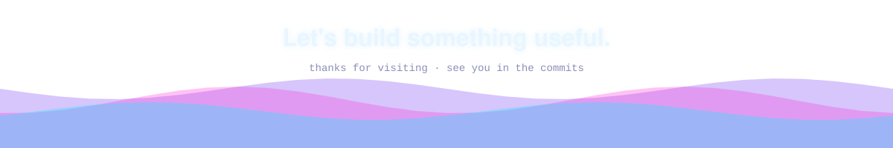
