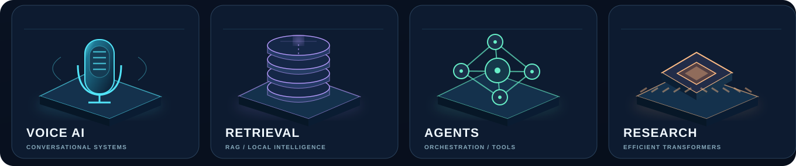
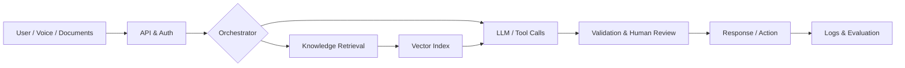

<!--
  SIVANESAN B | Main GitHub Profile README
  Design system: 3D Command Core / deep navy + electric cyan + soft violet
  The hero and project gallery are repo-hosted SVG assets rendered directly in GitHub.
  No website, JavaScript runtime or WebGL iframe is required to see the visuals.
  Prior profile safely preserved: backup/readme-before-native-3d-2026-11-01
-->

 

**AI Engineer · Generative AI · Forward Deployed Engineer · RAG / LLM · Voice AI · Agentic Systems**

*My ninja way: turn curiosity into practical AI products — one mission, one iteration, one deployment at a time.*

 

  

---

### Prologue / My Ninja Way 🍥

> **"Every project is a new mission. Every bug is a training arc."**

From the first line of Python to building AI products, I see my engineering journey through the story of **Naruto**: curiosity, training, teamwork, setbacks, perseverance, and finally building something that helps people.

<table>
<tr><td align="center" width="20%"><b>🍥 Naruto</b> Never give up</td><td align="left">I keep iterating until an AI prototype becomes something people can actually use.</td></tr>
<tr><td align="center"><b>⚡ Sasuke</b> Precision</td><td align="left">Careful debugging, model evaluation, and attention to the smallest implementation details.</td></tr>
<tr><td align="center"><b>📘 Kakashi</b> System design</td><td align="left">Connecting models, tools, APIs, retrieval, UI, and infrastructure into one coordinated system.</td></tr>
<tr><td align="center"><b>🌙 Itachi</b> Think ahead</td><td align="left">Security, reliability, trade-offs, and building systems that hold up beyond the demo.</td></tr>
</table>

**The five arcs of my developer story**

`01 — Academy` Learned Python, AI and Data Science fundamentals.  
`02 — Team 7` Started combining ML, software, APIs and collaboration.  
`03 — Chūnin Exams` Built and tested RAG systems, agents, and voice interfaces.  
`04 — Sage Training` Explored efficient LLM inference, evaluation, and deployment.  
`05 — The Hokage Dream` Keep building useful, dependable AI for real users.

<b>🎮 Open the original 3D AI Command Core</b>

 

---

### 01 / The engineer behind the systems

Hi, I'm **Sivanesan B** — an AI & Data Science graduate, AI engineer and builder interested in everything from language model inference to user-facing products.

My focus is translating a good AI prototype into an **end-to-end system**: ingestion, retrieval, agents, APIs, interface, testing, monitoring and deployment.

- **Build:** Generative AI workflows, RAG search and task-focused agents.
- **Explore:** Speech interfaces, voice infrastructure and offline-first assistants.
- **Engineer:** Python backends, TypeScript interfaces, databases, secure integrations and testing.
- **Research:** Resource-efficient LLM inference, activation freezing and responsible compute.
- **Next:** Full-time AI engineering roles involving GenAI, Voice AI, RAG and applied AI systems.

### 02 / AI systems laboratory

| Featured build | Engineering focus | Source |
| :--- | :--- | :---: |
| **🎙️ VoiceForge AI** | Provider-aware voice-agent control plane for configuring agents, recording calls, handling provider connections and tracking usage. Integrations depend on configured credentials. | [Explore](https://github.com/Sivanesanbalu/VoiceForge-AI) |
| **📚 Offline Voice RAG Assistant** | Local knowledge querying with CSV, FAISS similarity search, Whisper-compatible speech input and Qwen-family language models. | [Explore](https://github.com/Sivanesanbalu/RAG-Offline-Inventory-Management-System) |
| **🤖 AI Job Agent v2** | Agent workflow design for discovering roles, matching resumes, handling browser forms and tracking the application lifecycle. | [Explore](https://github.com/Sivanesanbalu/ai-job-agent-v2) |
| **🗣️ LinguaBridge AI** | Tamil/Hindi telephone translation architecture, provider adapters and deterministic simulations. **Not production-verified.** | [Explore](https://github.com/Sivanesanbalu/linguabridge-ai) |
| **🛡️ DevShield AI** | Defensive engineering research on release exposure, API abuse and protected application access. **Pre-production.** | [Explore](https://github.com/Sivanesanbalu/devshield-ai) |
| **🏭 Instrument Dealer Hub** | Industrial procurement and quotation workflow experiments: supplier discovery, structured RFQs and communications. | [Explore](https://github.com/Sivanesanbalu/whatsapp-instrument-connect) |

> **How I approach engineering:** build the prototype, prove its behavior, expose its limitations, then improve reliability before making production claims.

### 03 / Research that shapes the engineering

**Eco-Transformers**

*Carbon-Efficient and Accelerated Inference through Self-Pruning and Activation Freezing in Large Language Models*

Published at **ICNGCS 2025**. The research explores ways to make transformer inference more efficient through self-pruning and activation freezing. I apply that curiosity about **latency, memory and compute** to practical AI engineering decisions.

### 04 / Architecture + technology

| Layer | Tools and practices |
| :--- | :--- |
| **Generative AI** | LLM APIs, PyTorch, Hugging Face, LangGraph, prompt and context design |
| **Retrieval** | RAG, FAISS, embeddings, CSV/document indexing and search evaluation |
| **Speech & agents** | Whisper, Qwen, Vapi, conversational workflows, human review |
| **Software** | Python, TypeScript, FastAPI, Next.js, React, Node.js |
| **Infrastructure** | PostgreSQL, Supabase, Docker, Vercel, GitHub Actions |
| **Quality** | Git, CI, automated tests, API checks, Playwright |

<b>See how the system pieces connect</b>

*Illustrative architecture — projects use different subsets of these components.*

### 05 / GitHub universe

<b>View the animated contribution snake</b>

 

---

### Let's build something useful.

**Open to AI Engineer / GenAI / RAG / Voice AI opportunities and technical collaboration.**

[**Portfolio**](https://sivanesanbalu.netlify.app) · [**LinkedIn**](https://www.linkedin.com/in/sivanesan-b-871ba7264/) · [**Email**](mailto:apsiva69@gmail.com) · [**GitHub Repositories**](https://github.com/Sivanesanbalu?tab=repositories)

Naruto-inspired fan tribute with original vector art; not affiliated with the Naruto creators. Original 3D Command Core preserved above. GitHub Markdown does not execute interactive JavaScript/WebGL scenes.

