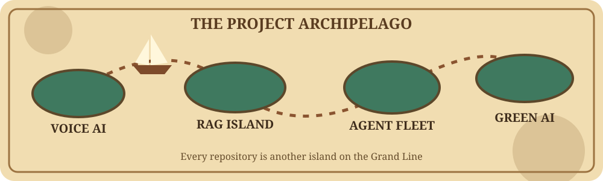
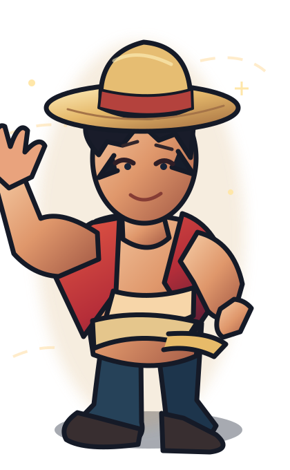
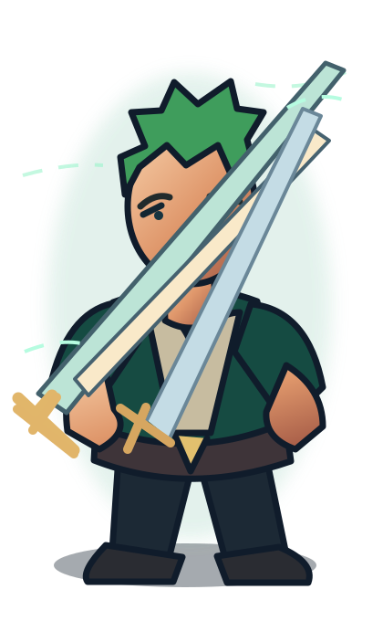
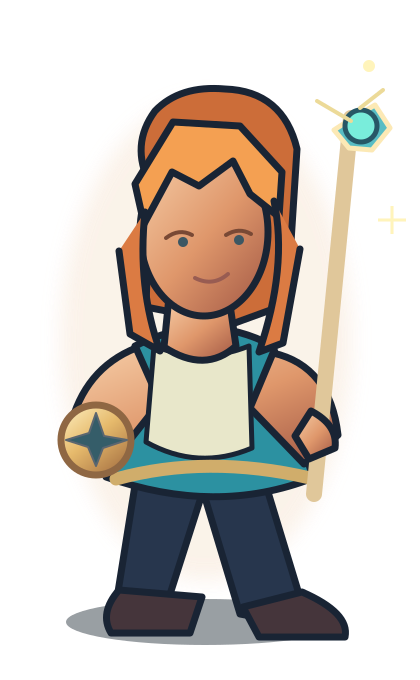
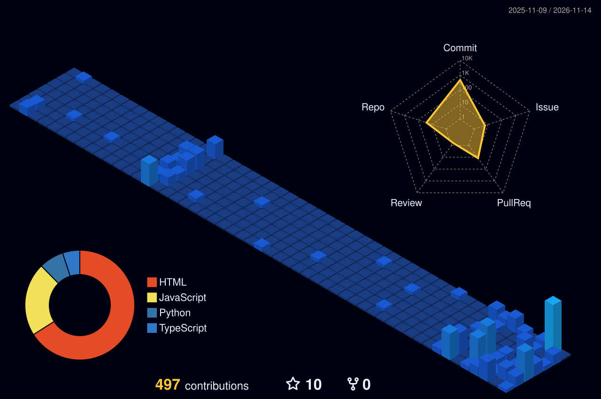
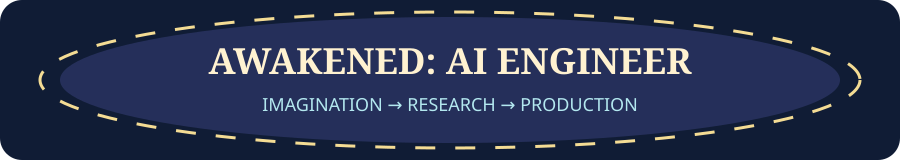

<!--
  SIVANESAN B · THE ENGINEER'S GRAND LINE
  Original animated art is stored in this repository.
  Previous README: backups/README-before-main-redesign-2026-11-01.md
-->

 

### Building useful AI, one island at a time. 🏴‍☠️

**AI Engineer · Generative AI · RAG · Voice AI · Agentic Systems · Efficient LLMs**

I turn ideas into working AI applications — from voice interfaces and offline knowledge assistants to agent workflows and full-stack products.

 

<a href="https://www.linkedin.com/in/sivanesan-b-871ba7264/">LinkedIn</a> ·
<a href="https://github.com/Sivanesanbalu?tab=repositories">All repositories</a> ·
<a href="https://doi.org/10.1109/ICNGCS64900.2025.11183217">IEEE paper</a> ·
<a href="mailto:apsiva69@gmail.com">Email</a>

---

## 🧭 The Captain's Log

I'm **Sivanesan B**, an AI & Data Science graduate from **Kumaraguru College of Technology**, based in **Coimbatore, India**.

I enjoy the engineering work that happens *after* the first AI demo: reliable APIs, data retrieval, evaluation, workflow orchestration, speech interfaces, and deployment.

- **What I build:** GenAI applications, conversational voice experiences, retrieval systems, and practical automations.
- **How I build:** Python and TypeScript, full-stack development, experimentation, and iterative testing.
- **What I'm exploring:** Multi-agent coordination, offline/private AI, and lower-cost LLM inference.
- **Open to:** AI Engineer, Applied AI, GenAI, RAG/LLM, and Voice AI opportunities — including collaborative product projects.

> *The Grand Line is the theme. The engineering and projects are the real story.*

## 🗺️ Project Islands — Explore the Work

<table>
<tr>
<td width="50%" valign="top">

### 🎙️ VoiceForge AI
**A voice-agent control plane.**

A multilingual Next.js application for voice-agent configuration, call records, extracted data, and provider integrations.

<code>Next.js</code> <code>TypeScript</code> <code>Voice AI</code>

[**Explore VoiceForge →**](https://github.com/Sivanesanbalu/VoiceForge-AI)

</td>
<td width="50%" valign="top">

### 📚 Offline Voice RAG
**AI that can run without the cloud.**

A voice-enabled local knowledge assistant using CSV data, FAISS retrieval, Whisper speech recognition, and a compatible local LLM.

<code>Python</code> <code>FAISS</code> <code>Whisper</code> <code>Qwen</code>

[**Explore Offline RAG →**](https://github.com/Sivanesanbalu/RAG-Offline-Inventory-Management-System)

</td>
</tr>
<tr>
<td valign="top">

### ⚙️ Autonomous Job Agent
**Agent workflows meet browser automation.**

A project exploring job discovery, matching, application workflows, and visibility into runs and outcomes.

<code>Python</code> <code>Playwright</code> <code>Next.js</code> <code>LLMs</code>

[**Explore the Agent →**](https://github.com/Sivanesanbalu/ai-job-agent-v2)

</td>
<td valign="top">

### 🎧 AI Voice Recruiter
**Conversational interviewing concepts.**

A voice-oriented interview experience with adaptive questioning and experiments involving computer-vision-assisted monitoring.

<code>React</code> <code>Voice AI</code> <code>Computer Vision</code>

[**Explore Voice Recruiter →**](https://github.com/Sivanesanbalu/AI_Voice_Recruiter)

</td>
</tr>
<tr>
<td valign="top">

### 🏭 Instrument Dealer Hub
**AI workflows for industrial procurement.**

A B2B instrumentation project covering supplier discovery, quotation workflows, RFQs, and practical business operations.

<code>Procurement</code> <code>Automation</code> <code>Full Stack</code>

[**Explore the Hub →**](https://github.com/Sivanesanbalu/whatsapp-instrument-connect)

</td>
<td valign="top">

### 🌿 Eco-Transformers
**Making language models more efficient.**

Research into inference-time self-pruning and activation freezing to examine the computational and carbon costs of transformer models.

<code>PyTorch</code> <code>LLMs</code> <code>Efficiency Research</code>

[**Read the IEEE publication →**](https://doi.org/10.1109/ICNGCS64900.2025.11183217)

</td>
</tr>
</table>

**[⚓ Open every repository](https://github.com/Sivanesanbalu?tab=repositories)** · **[🗺️ Explore the cinematic project atlas](https://grand-line-3d-sivanesan.vercel.app/#work)**

---

## 📜 Research Log — Eco-Transformers

**Eco-Transformers: Carbon-Efficient and Accelerated Inference through Self-Pruning and Activation Freezing in Large Language Models**

Published at the **2025 International Conference on Next Generation Computing Systems (ICNGCS)**, IEEE.

This research examines runtime approaches to reducing transformer inference overhead, including masking low-magnitude weights and freezing near-zero activations. The published paper evaluates efficiency and output quality across multiple transformer models. Results depend on the model and experimental setup.

**[Read the publication on IEEE Xplore](https://doi.org/10.1109/ICNGCS64900.2025.11183217)** · DOI: <code>10.1109/ICNGCS64900.2025.11183217</code>

---

## 🛠️ The Engineering Toolkit

| Territory | Tools and areas |
| --- | --- |
| **AI & retrieval** | Python · LLMs · RAG · LangGraph · FAISS · PyTorch · Hugging Face |
| **Voice & agents** | Whisper STT · Vapi · Browser automation · Playwright · Workflow orchestration |
| **Applications** | TypeScript · Next.js · React · FastAPI · REST APIs |
| **Data & delivery** | PostgreSQL · Supabase · Docker · Git · Vercel |

<strong>⚙️ View a simple architecture I like to build around</strong>

 

<pre>
User / Application
        │
        ▼
API + Authentication
        │
        ▼
Agent / Workflow Orchestration
        ├─────────► Retrieval + FAISS
        ├─────────► LLM / Voice Tools
        └─────────► Validated Result
                         │
                         ▼
                  User / Application
</pre>

The exact components vary by project. See each repository for its implementation and setup requirements.

---

## 🏴‍☠️ Meet the Crew — Original Anime-Inspired Art

The inspiration is **One Piece's spirit of adventure**. These original animated pirate-style characters represent three parts of my engineering journey.

<table>
<tr>
<td align="center" width="33%">
 
<strong>THE DREAMER</strong> 
Curiosity & ambition
</td>
<td align="center" width="33%">
 
<strong>THE BUILDER</strong> 
Focus & execution
</td>
<td align="center" width="33%">
 
<strong>THE NAVIGATOR</strong> 
Strategy & exploration
</td>
</tr>
</table>

**[🌊 View the real interactive 3D galleon and articulated crew →](https://grand-line-3d-sivanesan.vercel.app/#real-3d)**

GitHub README supports images and animated SVGs; the linked portfolio renders the real-time Three.js 3D models, sails and character animations.

The illustrated pirate crew above uses original designs.

<strong>🎞️ Watch the actual Luffy animation reference I chose</strong>

 

 

This short One Piece excerpt is user-supplied fan reference footage, not a 3D model or original illustration. The portfolio keeps this separate from the original 3D pirate characters.

---

## 📈 The Voyage Continues

<picture>
  <source media="(prefers-color-scheme: dark)" srcset="https://raw.githubusercontent.com/Sivanesanbalu/Sivanesanbalu/output/github-contribution-grid-snake-dark.svg" />
  <source media="(prefers-color-scheme: light)" srcset="https://raw.githubusercontent.com/Sivanesanbalu/Sivanesanbalu/output/github-contribution-grid-snake.svg" />
  
</picture>

<strong>🌌 See my isometric contribution universe</strong>

 

<picture>
  <source media="(prefers-color-scheme: dark)" srcset="https://raw.githubusercontent.com/Sivanesanbalu/Sivanesanbalu/output/profile-night-view.svg" />
  <source media="(prefers-color-scheme: light)" srcset="https://raw.githubusercontent.com/Sivanesanbalu/Sivanesanbalu/output/profile-green-animate.svg" />
  
</picture>

---

### 🌅 The next island starts with a conversation.

I enjoy collaborating with people building useful AI products, developer tools, and research-driven systems.

**[📩 Email me](mailto:apsiva69@gmail.com)** · **[🤝 Connect on LinkedIn](https://www.linkedin.com/in/sivanesan-b-871ba7264/)** · **[⚓ See the complete portfolio](https://sivanesanbalu.netlify.app)**

 

Built with code, curiosity, and a little Grand Line energy. ✦

